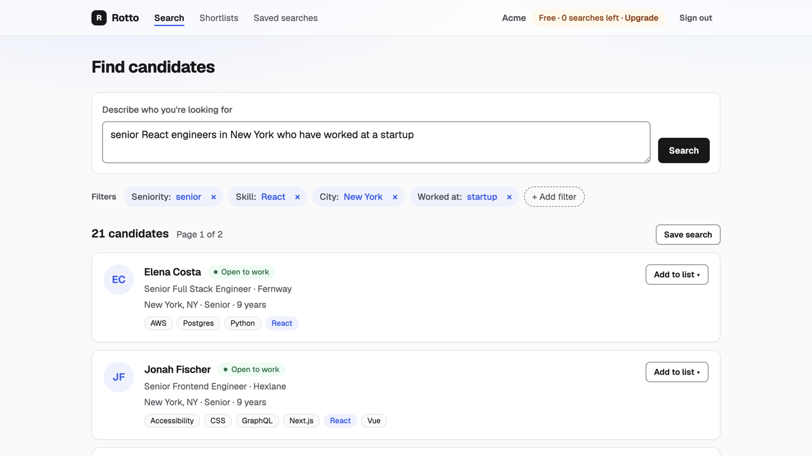
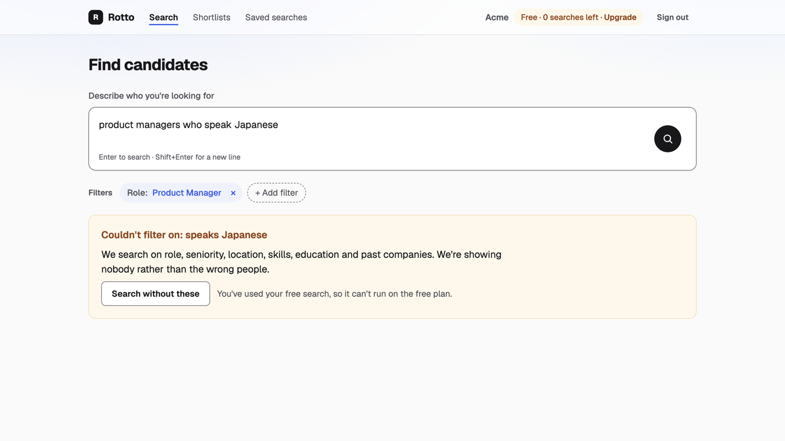
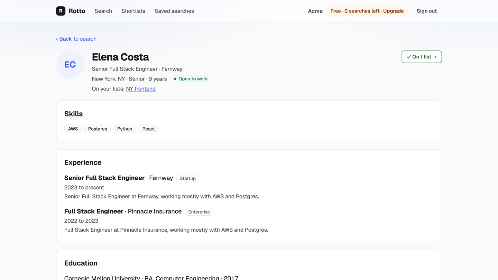
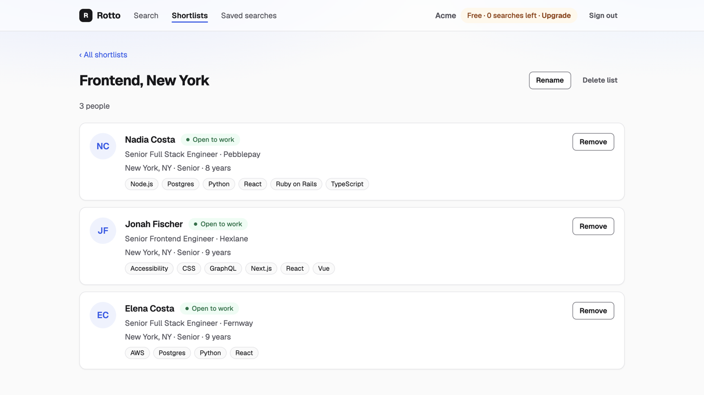
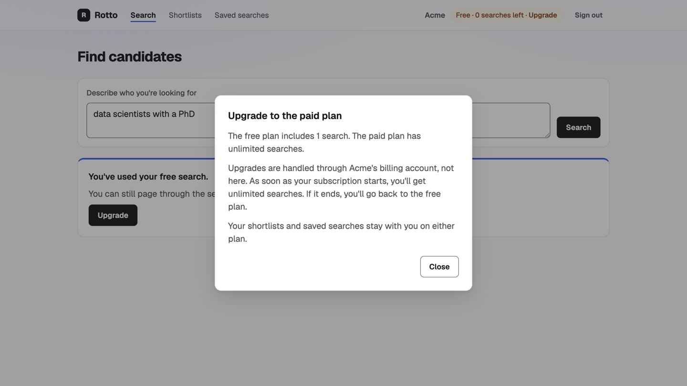

# Candidate Search recruiter search

Recruiters describe who they want in plain English; Claude turns the brief into structured filters; Postgres finds and ranks the people.

## Run it

Needs Docker Desktop running and Node 24.

```
export ANTHROPIC_API_KEY=sk-ant-...
export STRIPE_WEBHOOK_SECRET=whsec_test_sample
make setup
make dev
```

Open http://localhost:3000 and sign in as `recruiter@acme.test` or `recruiter@globex.test` (password `demo-password`).



## How to review (about 15 minutes)

1. This page, then [docs/ARCHITECTURE.md](docs/ARCHITECTURE.md) (requirements, API, high-level design, deep dives, decisions; the diagrams are inline, and the request map in section 3 shows every route).
2. Core code, in this order: `supabase/migrations` (schema, RLS), `src/server/search` (LLM and SQL), `src/server/plan.ts` (free plan), `src/server/billing` (webhook), `app/api` (thin routes).
3. Run the checks with the app running: `npm test` (unit), `npm run test:integration` (tenancy, free plan, billing, hostile briefs, latency), `npm run e2e` (Cypress), `npm run eval:search` (accuracy report), and `npm run build && npm run check:secrets` (with `make dev` stopped). `test:integration`, `e2e` and `eval:search` together call Claude about 40 times, a few cents. Details in [docs/TESTING.md](docs/TESTING.md).
4. Decisions and their reasons are in [ARCHITECTURE.md section 7](docs/ARCHITECTURE.md#7-decisions); the commit history follows [docs/IMPLEMENTATION_PLAN.md](docs/IMPLEMENTATION_PLAN.md); working rules are in [RULES.md](RULES.md).

## Screens

| | |
|---|---|
|  |  |
|  |  |

On a phone: [results](docs/screenshots/phone-03-search-results.png), [candidate](docs/screenshots/phone-04-candidate.png), [saved searches](docs/screenshots/phone-07-saved-searches.png), [limit](docs/screenshots/phone-09-limit.png). `npm run screenshots` takes them again from the running app.

## How search works

The data is fully structured with closed vocabularies (13 roles, 4 seniority levels, 10 cities, 79 skills, schools, degrees, company types). The 10 sample briefs are reproduced exactly by AND-ing those fields, so search is a translation problem. Claude Haiku receives the brief and a forced tool whose schema lists every allowed value as an enum. The validated filters go to one static SQL statement as typed parameters. Every match is stored with a fixed rank, so paging is a primary-key read and each person appears exactly once.

- **Understanding the brief:** Claude maps phrasing to exact values ("Golang" is Go, "NYC" is New York, "looking for a new role" is open to work). "Engineers", "software engineers" or "developers" with no qualifier mean every engineering role, so "software engineers in California" finds all 831 of them, and "senior engineers in Denver" leaves out product managers.
- **Ranking:** closer matches first (people who match more of the brief's companies, schools or degrees), then open to work, then most experienced. Every result matches every requirement.
- **Why not keyword or embedding search:** headlines and job descriptions are generated from the same structured fields, so they add nothing to match on. Fuzzy matching would add wrong people and could never return nobody, and the answer is an exact set of people.

**Accuracy:** `npm run eval:search` scores the 10 sample briefs and 15 of my own (synonyms, states, years, umbrella titles, vague and unanswerable asks): precision, recall and page-1 precision are 100% on all 25.

## Keeping the LLM honest

Four layers: enum-only tool schema built from the live data; zod re-validation that drops unknown values; an `unsupported` list for anything the data cannot answer ("speaks Japanese"); and a strict rule that an unsupported requirement, or no usable filter at all, returns nobody instead of the wrong people. Briefs are treated as data, never as instructions, and never reach SQL as text.

## Model, cost and speed

`claude-haiku-5-5`: the fastest Claude model, made for extraction, accurate enough because the schema does the heavy lifting. The system prompt and tool are cached.

- **Cost per search:** about $0.0003 when the prompt cache is warm, about $0.0007 on the first search after 5 quiet minutes (the cache is written again). Measured from the search log: about 220 input and 430 output tokens, plus the 3,900-token cached prompt and tool. That is roughly 1,500 to 3,500 searches per dollar.
- **Speed (measured on `make dev`):** a new search takes 1.6 to 2.2 s end to end with a warm cache and up to about 2.7 s on a cold one, almost all of it the Claude call (target under 3 s). Paging takes 74 ms at p95 (target under 300 ms). SQL finds, ranks and stores even the broadest search (831 people) in about 50 ms.

## Billing

Plans follow Stripe subscription events sent to `POST /api/billing/events`: the signature is checked on the raw body, each event is applied once, and an older event never overwrites a newer one. To watch it work, with `make dev` running:

```
npm run replay:stripe    # acme free, globex paid
make reset               # back to the seed state
```

## Tradeoffs

- Strict matching favours precision; a brief phrased in ways the prompt does not anticipate can return nothing.
- Editing filters counts as a new search on the free plan, so editing filter tags cannot be used to dodge the limit.
- Results are stored per search: fast, stable paging at the cost of extra rows.
- Webhook signatures are always checked, but the age check is off by default; replays are blocked by event id instead.
- Candidates are readable only through the server, so the free limit cannot be bypassed through Supabase directly.

Every decision and the alternatives considered are in [ARCHITECTURE.md](docs/ARCHITECTURE.md#7-decisions) sections 7 and 8.

## Troubleshooting

| Problem | Fix |
|---|---|
| `make setup` says Docker isn't running | Start Docker Desktop and wait until it says it's running, then run `make setup` again |
| Supabase fails to start with "no space left on device" | Docker is out of disk space: `docker system prune` (removes stopped containers and unused images), or raise the disk limit in Docker Desktop settings |
| `make dev` fails with `EADDRINUSE :::3000` | An old dev server is still running: `lsof -iTCP:3000 -sTCP:LISTEN`, then `kill <pid>` |
| A port like 54321 or 54322 is in use | Another Supabase project is running: `npx supabase stop --all`, then `make setup` |
| `make setup` says the Node version is wrong | `nvm use` (the version is in `.nvmrc`) |
| `make dev` stops asking for `ANTHROPIC_API_KEY` or `STRIPE_WEBHOOK_SECRET` | Export both in the same shell before `make dev`; the sample events use `whsec_test_sample` |
| Pages hang after running `npm run build` | `next build` and `next dev` share `.next`; stop `make dev` before building, then start it again |

## With another week

- Cache filters per normalised brief, so a repeated brief skips Claude.
- Keyword or embedding search alongside the filters, once profiles carry free text (resumes, bios) that no field covers.
- Soft preferences and "did you mean" suggestions when results are empty.
- A regression set of a few hundred labelled briefs.
- Streaming the filter tags while results load; an audit log for billing events.
