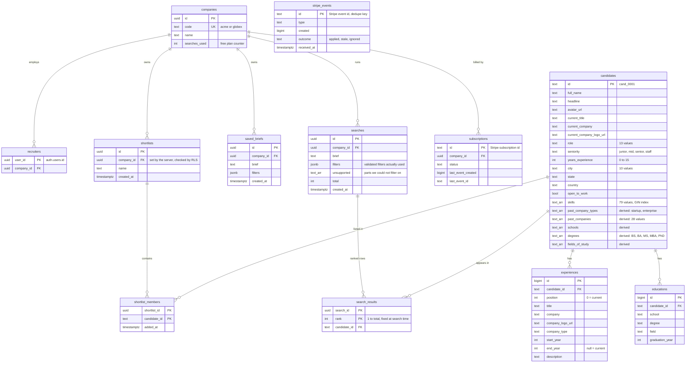
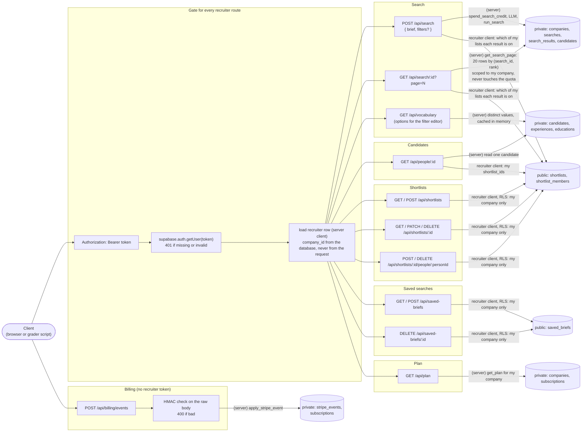
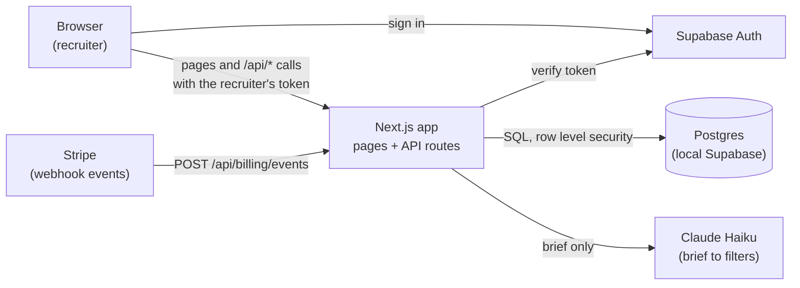
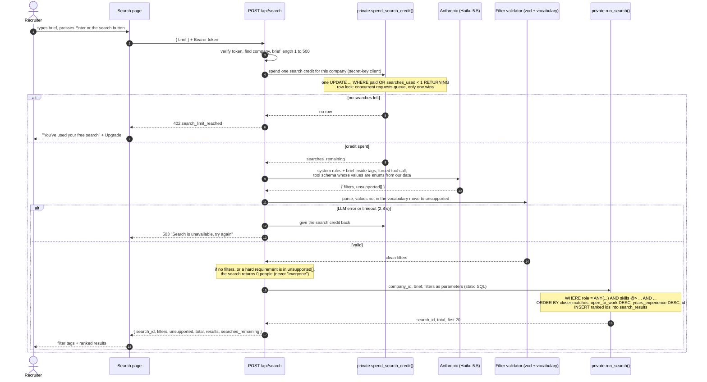
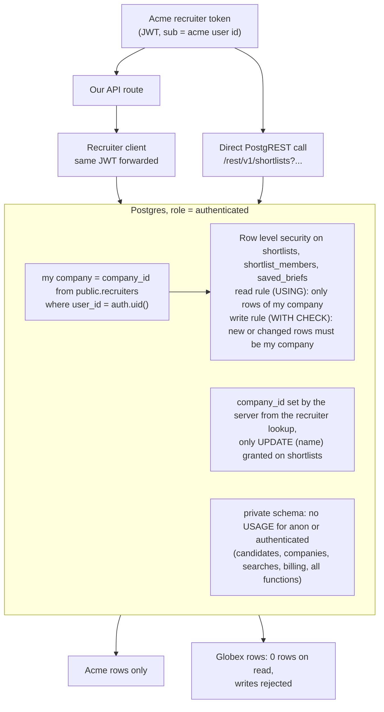
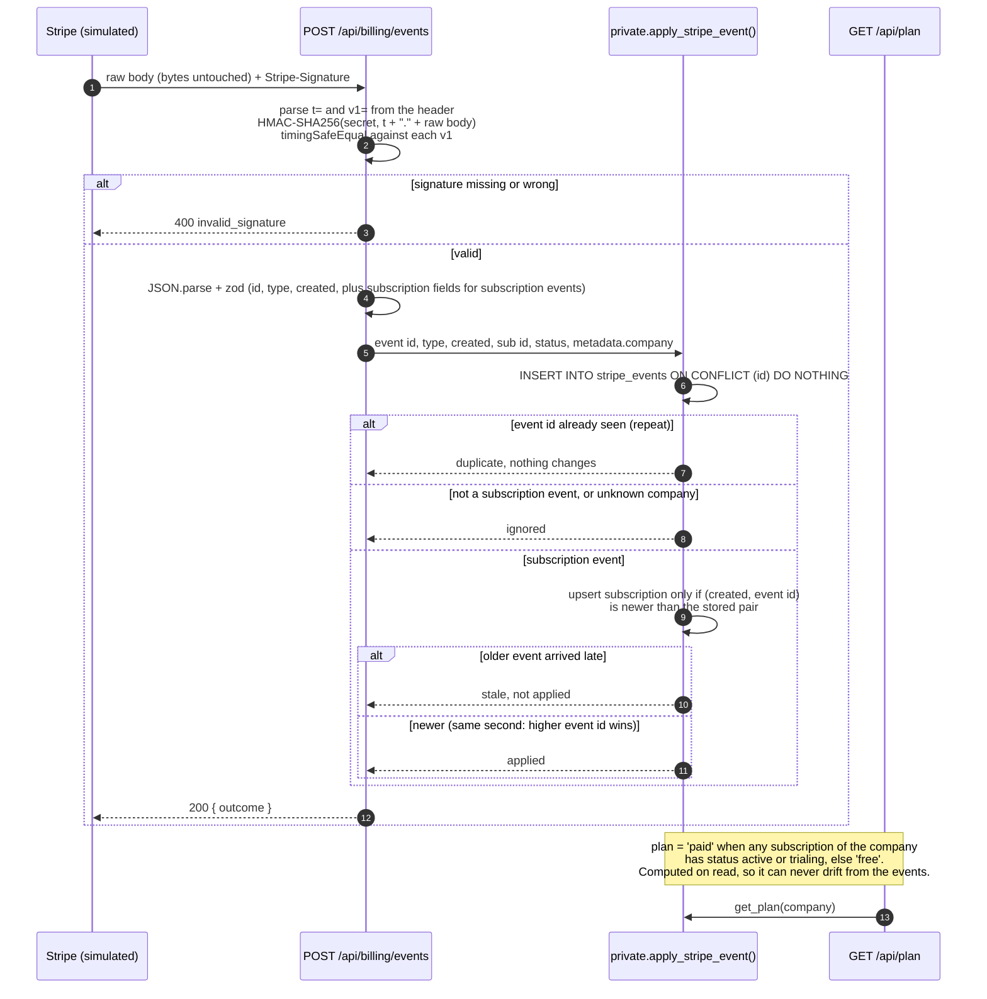

# Architecture

> **Key insight.** I profiled all 5,000 candidates before designing. Every field a recruiter filters on is structured with a small closed vocabulary, and **all 10 sample briefs are reproduced exactly by AND-ing those fields**. So search is a *translation* problem (brief to the right filter values), not a fuzzy ranking problem. Most of the design follows from that.

## 1. Requirements

### 1.1 Functional requirements

Recruiters should be able to:

- **FR1** search for candidates by describing them in plain English, and see the filters the app understood plus ranked, paged results, where each result opens the candidate and says which of their shortlists the candidate is already on;
- **FR2** correct a search by editing or removing any understood filter, without retyping the brief;
- **FR3** view a candidate's experience, education and skills;
- **FR4** create, rename and delete named shortlists, add or remove candidates, and see their newest shortlists on the search start page;
- **FR5** save a search and re-run it later, and see their newest saved searches on the search start page;
- **FR6** see their company, plan and searches remaining (free plan: 1 search in total, paging is free);

and the system should:

- **FR7** move a company between free and paid from Stripe webhook events.

### 1.2 Non-functional requirements

| # | The system should... | Target |
|---|---|---|
| NFR1 | isolate companies completely | no read or write of another company's shortlists or saved searches, through our API **or** directly through Supabase |
| NFR2 | keep secrets on the server | no Supabase secret key or model key in any page or bundle |
| NFR3 | be precise over exhaustive | return nobody rather than the wrong people |
| NFR4 | be strongly consistent on the quota | exactly 1 free search, even with many concurrent requests |
| NFR5 | process billing events exactly once and in order | signature verified, repeats ignored, older event never overwrites newer |
| NFR6 | be fast | paging under 300 ms; new search under 3 s including the LLM |
| NFR7 | survive hostile input | SQL or prompt injection cannot crash the app, return everyone, or change data |
| NFR8 | be reproducible | `make setup` and `make dev` work on a clean Mac |
| NFR9 | work on desktop and phone, accessibly | WCAG 2.1 AA basics: keyboard, focus, contrast, labels |

**Scale.** 5,000 candidates, 2 companies, 1 recruiter each. At this size a single Postgres with no cache layer is enough. At real scale the same filter approach holds, with composite indexes, capped stored results, filters cached per normalised brief, and webhooks processed from a queue. Keyword or embedding search would only be added for free-text profiles (resumes, bios) that no structured field covers, and alongside the filters, not instead of them.

### 1.3 Out of scope

Sign-up, password reset, invites; real Stripe checkout (an Upgrade dialog explains it); candidate contact details; email; deployment.

**Release.** This is an assessment that runs locally only (`make setup`, `make dev`), so there are no release steps. For production the next steps would be: preview, staging and production environments; migrations applied by CI before each deploy; secrets in a managed store; the webhook endpoint registered with Stripe per environment; error and latency monitoring on search and billing; and a rollback plan for code and migrations.

## 2. Core entities

| Entity | What it is |
|---|---|
| **Company** | A customer (`acme`, `globex`), holds the free-search counter |
| **Recruiter** | A Supabase Auth user who belongs to one company |
| **Candidate** | Shared by all companies; with child **Experience** and **Education** rows |
| **Search** | One run of a brief: the filters actually used, the total, owned by a company |
| **SearchResult** | A candidate at a fixed rank inside one search (what paging reads) |
| **Shortlist** / **ShortlistMember** | A company's named list and the candidates on it |
| **SavedBrief** | A company's saved brief plus its filters |
| **Subscription** / **StripeEvent** | Billing state per Stripe subscription, and every processed event id |

Data model (LLD section 2 has every column, index and policy):

## 3. API

Every recruiter route takes `Authorization: Bearer <supabase access token>`.

| Route | Returns | Errors |
|---|---|---|
| `POST /api/search` `{ brief, filters? }` | `{ search_id, filters, unsupported, total, results[20], searches_remaining }`; each result says which of my lists the candidate is on | 400, 401, 402 limit reached, 503 LLM down |
| `GET /api/search/:id?page=N` | `{ search_id, page, page_size, total, results }` | 400, 401, 404 |
| `GET /api/vocabulary` | allowed values for the filter editor | 401 |
| `GET /api/people/:id` | candidate + experiences + education | 401, 404 |
| `GET` / `POST /api/shortlists` | lists with counts / `{ id }` | 400, 401 |
| `GET` / `PATCH` / `DELETE /api/shortlists/:id` | members / rename / delete | 401, 404 |
| `POST` / `DELETE /api/shortlists/:id/people/:personId` | 200 (adding twice changes nothing) | 401, 404 |
| `GET` / `POST /api/saved-briefs`, `DELETE /api/saved-briefs/:id` | list / `{ id }` / 204 | 400, 401, 404 |
| `GET /api/plan` | `{ plan: "free" or "paid", searches_remaining: number or null, company_name }` | 401 |
| `POST /api/billing/events` (no token) | 200, also for repeats and ignored types | 400 bad signature |

Another company's resource returns **404, not 403**, so the API never confirms it exists. Errors share one shape: `{ error: { code, message } }`.

How each route is authorised and what it touches:

## 4. High-level design

It is one Next.js app; everything else is a dependency it talks to.

- **Browser:** React pages. Holds only public values (Supabase URL and publishable key) and the recruiter's session.
- **Next.js app:** serves the pages and the API routes. Server code is organised by feature (search, plan, billing, shortlists, saved searches, people), but it is one process, not separate services.
- **Supabase Auth:** issues and verifies recruiter tokens.
- **Postgres:** one database with Row Level Security on every company table.
- **Claude Haiku:** only turns a brief into filters.
- **Stripe:** simulated by signed webhook events sent to one API route.

How each requirement flows:

- **FR1 Search.** The browser sends the brief to `POST /api/search`. The route verifies the token, spends one search credit, asks Claude for filters, validates them, runs one SQL query, stores the ranked ids and returns page 1. *(Deep dives 6.1 to 6.3.)*
- **FR2 Correct.** The browser sends the edited filters with the brief; Claude is skipped, everything else is the same. It counts as a new search.
- **FR3 View.** `GET /api/people/:id` reads one candidate with experiences and education. Clicking anywhere on a result card opens it.
- **FR4, FR5 Lists and saved searches.** Simple create, read, update and delete, run as the recruiter so RLS limits it to their company. The same recruiter-scoped read tells each search result which lists the candidate is on, and feeds the at-a-glance tiles on the start page. *(Deep dive 6.4.)*
- **FR6 Plan.** `GET /api/plan` returns the company name, the derived plan and searches remaining.
- **FR7 Billing.** `POST /api/billing/events` verifies the signature and applies the event once and in order. *(Deep dive 6.5.)*

## 5. Tech stack and why

Chosen to match what I have used in production wherever the brief leaves a choice.

| Area | Choice | Why |
|---|---|---|
| Framework | Next.js 16 App Router, TypeScript strict, Node 24 | Required. The App Router provides routing, nested layouts, dynamic routes and the API route handlers. Pages that need the recruiter's session are client components that call our own API, so the browser and API clients use one code path |
| UI | React, React Context + hooks, CSS Modules | My daily stack. Only two pieces of global state (session, plan), so Redux or MobX would be overkill. Plain CSS is easy to change live |
| Database | Postgres via Supabase CLI 2.119.0, pinned as an npm devDependency | Required version, installed by `npm ci`. SQL and query design carry over from my MySQL work |
| DB access | `@supabase/supabase-js` | One client for auth, tables and SQL functions |
| Validation | `zod` | One schema validates request bodies **and** the LLM's output, and gives the TypeScript types |
| LLM | Anthropic `claude-haiku-5-5` | Fastest Claude model, built for extraction. About $0.10 / $0.50 per million input / output tokens, so well under $0.001 per search |
| Webhook signature | Node `crypto` HMAC | About 20 lines, no Stripe SDK; lets us choose the timestamp rule |
| Unit + integration tests | Jest | My team's standard; Next.js has an official Jest setup |
| End-to-end tests | Cypress, `cy.intercept` for API mocking, `cypress-axe` for accessibility | The stack I used for our end-to-end and accessibility work; mocking makes loading, empty, error and limit states testable |
| CI | GitHub Actions: typecheck, lint, unit tests on every PR | Automated gating before merge, like our trunk-based release process |

## 6. Deep dives

Each deep dive states the problem, the decision and why. The diagrams carry the step-by-step detail.

### 6.1 Accurate search without invented filters

**Problem:** the LLM could map a brief to filters the data can't support, or be talked into ignoring its instructions.

**Decision:** the LLM fills a forced `set_filters` tool whose JSON schema lists only values that exist in the data (13 roles, 4 seniority levels, 10 cities, 79 skills, schools, degrees, company types). The vocabulary is loaded from Postgres, so the schema and the zod validator can't disagree. zod drops anything else, and anything the model can't express goes into `unsupported`. If a hard requirement is unsupported, or no filter was extracted, the search returns nobody and says why. The brief is passed as tagged data and never reaches SQL as text.

**Why:** the sample answers are exact AND matches (for example "senior" means exactly senior, and "enterprise sales experience" is a skill, not a company type), so precision comes from mapping to the right values, not from fuzzy matching.

A new search, step by step:

### 6.2 Fast, consistent paging

**Decision:** a search stores its ranked matches in `search_results (search_id, rank, candidate_id)`. A page is a primary-key range read.

**Why:** under 50 ms locally, never touches the quota or the LLM, and every result appears exactly once in a fixed order.

### 6.3 Exactly one free search under concurrency

**Decision:** one conditional `UPDATE companies SET searches_used = searches_used + 1 WHERE id = $1 AND (paid OR searches_used < 1) RETURNING ...`, run **before** the LLM call. Postgres row locking lets exactly one of N concurrent requests through; the rest get 402. This step is `private.spend_search_credit()`. If the LLM fails, `private.refund_search_credit()` gives the credit back.

**Why:** atomic in the database, so it holds across server processes, unlike check-then-insert or an in-memory lock.

### 6.4 Tenant isolation, including direct Supabase calls

**Decision:** three layers. The API takes the company from the database, never from the request. Shortlists and saved searches are read and written as the recruiter (their token), so Postgres Row Level Security applies. Every company table in `public` has an RLS policy with a **read rule** (`USING`, an automatic `WHERE company_id = my company` on every select, update and delete) and a **write rule** (`WITH CHECK`, which rejects any inserted or updated row that would belong to another company); everything else (candidates, the search counter, searches, billing) lives in a `private` schema with no access for recruiters, RLS enabled with no policies, and `EXECUTE` revoked on private functions.

**Why:** the RLS layer is what stops a recruiter who calls Supabase directly with their own token. Candidates are only readable through our server so the free limit can't be bypassed.

### 6.5 Stripe webhooks exactly once and in order

**Decision:** HMAC check on the raw body with a timing-safe compare (400 on mismatch); `INSERT ... ON CONFLICT (event id) DO NOTHING` to ignore repeats; apply a subscription change only if its `event.created` is newer than the last applied one; derive the plan on read (paid if any subscription is `active` or `trialing`).

**Why:** idempotent and order-safe in one transaction, and a derived plan can't drift from the events.

### 6.6 Secrets and hostile input

Secrets are never prefixed `NEXT_PUBLIC_`, server modules import `server-only`, and a test scans the built bundle. SQL injection has nowhere to go because filters are typed parameters; prompt injection is contained by the enum schema, validation and the empty-result rule.

### 6.7 Latency

Paging is a primary-key read. A new search uses Haiku with a cached prompt, short output and a 2.8 s timeout; SQL takes under 100 ms (the broadest realistic search, 831 matches, finds, ranks and stores them in about 50 ms). Each search logs LLM, SQL and total time and its token counts. Measured on `make dev` (Oct 9): paging p95 74 ms; a new search 1.6 to 2.2 s end to end across all 25 eval briefs with a warm prompt cache, about 2.7 s with a cold one. Cost per search about $0.0003 warm, $0.0007 cold.

## 7. Decisions

Decisions made while designing and building, with the reason for each. Section 5 covers the tech stack and section 8 the alternatives considered.

### 7.1 Product decisions (confirmed October 8)

1. **Editing filters or re-running a saved search counts as a new search.** Otherwise a free user could search without limit by editing filters. The UI says so before running it on the free plan.
2. **An unsupported requirement returns nobody**, with the reason shown ("Couldn't filter on: speaks Japanese"). Returning nothing beats returning the wrong people.
3. **Webhook: HMAC always checked on the raw body, age check off by default**; `STRIPE_WEBHOOK_TOLERANCE_SECONDS` turns it on. The pre-signed sample events may be replayed days later, and repeats are already blocked by event id. Events are ordered by `event.created`.
4. **Paid means a subscription with status `active` or `trialing`.** `past_due`, `incomplete`, `unpaid` and `canceled` are free.

### 7.2 Design and build decisions

| Date | Area | Decision | Why |
|---|---|---|---|
| Oct 8 | Search | Enum-constrained filters built from the live data, results stored per search for paging | All 10 sample briefs are exact AND matches over structured fields |
| Oct 8 | UI | Pages call our own `/api/*` routes with the recruiter's Bearer token | The browser and API clients exercise one code path, with one place to enforce rules |
| Oct 8 | UI | Visual direction "graphite and blue": near-black buttons, one blue accent, soft blue wash behind the page, Geist font; light theme only | Modern and calm, keeps attention on the results, every text pair meets WCAG AA |
| Oct 8 | Database | Two schemas: `public` holds only the tables a recruiter uses with their own token (recruiters, shortlists, shortlist members, saved searches), all under RLS; everything else lives in `private`, reachable only by the server | Keeps the RLS surface to four tables, and data a recruiter must never read has no access path at all, instead of sitting in `public` behind a deny-all policy that one later grant could undo |
| Oct 8 | Workflow | Work split into stories (database, API, UI and tests for one feature), each with a plan reviewed before coding; one branch and pull request per story, merged with a merge commit or rebase (never squash) | Every merged story works end to end, and history stays readable |
| Oct 9 | Search | No keyword (lexical) or embedding (semantic) search, and no custom index | Headlines and job descriptions are generated from the structured fields, so they add nothing to match on; fuzzy matching adds wrong people and can't return nobody. SQL already takes under 100 ms |
| Oct 9 | Search | "Engineer", "software engineer" or "developer" with no qualifier means every engineering role | Otherwise "software engineers" returns nobody and "staff engineers" includes non-engineers |
| Oct 9 | Search | Rank closer matches first (more of the brief's values in multi-value fields), then open to work, then experience | Puts the best of the right people on page 1 |
| Oct 9 | Search | No brief → filters cache yet | The graders run each brief once and the 3 s target is met without it; kept as a next step |
| Oct 9 | Free plan | Adding a filter to a search already run still counts as a new search, for now | Adding a filter only narrows results the recruiter was already given, so it could safely be free, but the server would have to prove the new filters are a strict narrowing of a stored search, and a mistake there is a free-plan bypass. Listed as a next step |
| Oct 9 | UI | After Sign out, the next sign-in opens Search; a link opened while signed out still returns to its page | Signing out on one page and in as another company used to land on that page |
| Oct 9 | Search | The Claude request stays as it is: thinking off and effort `low` were both measured and neither made a search faster | Across 4 briefs the means were 1.81 s (as is), 1.85 s (thinking off) and 1.80 s (effort low), with the same filters. Most of the time is fixed per call, not output |

### 7.3 Facts from the data that shaped these decisions

- 5,000 candidates, all US: 10 cities, 13 roles, 4 seniority levels (junior 0 to 2 years, mid 3 to 5, senior 6 to 9, staff 10 to 15), 79 skills, 13 schools, 5 degrees, 14 fields of study, 28 companies, 2 company types.
- Experience 0 is always the current job; each candidate has exactly one education entry.
- In `data/queries.json`, "senior" is exact (not staff), "worked at a startup" means any experience at a `startup` company, "enterprise sales experience" is the skill `Enterprise Sales`, and "speaks Japanese" has no data, so the expected answer is nobody.
- "React engineers" in the first sample is the skill React with no role: adding the role Frontend Engineer returns 6 people instead of the expected 21.
- `data/stripe-events.json` signatures verify with the secret `whsec_test_sample` used as-is. Expected final plans: acme free, globex paid.

## 8. Tradeoffs

| Decision | Alternative | Why |
|---|---|---|
| Enum-constrained filters, empty result on unsupported asks | Full-text or embedding search | The data is structured and the answer key is exact sets; fuzzy search would add wrong people and break "return nobody". The free text (headlines, job descriptions) is generated from the structured fields, so it adds nothing to match on |
| Store ranked ids per search | Re-run the query per page | Fast, stable paging, every result exactly once |
| Quota in one conditional `UPDATE` | App-level lock | Atomic in the database, works across processes |
| Spend the search credit before the LLM, give it back on failure | Count after success | Correct under concurrency; users don't lose a search to our outage |
| Plan derived from subscriptions | Stored plan column | Cannot drift |
| Own HMAC check | Stripe SDK | Small, explainable, timestamp rule under our control |
| Candidates only through the server | Public read via Supabase | Closes the free-plan bypass |
| Client components + API routes | Server components with cookie sessions | App and grader use the same code path; less Next.js surface to learn |

## 9. Code organisation

Three layers with a clear split between data, API and UI. **UI:** `app/(app)` pages, `src/components`, `src/client` (fetch wrapper that adds the token). **API:** `app/api/**/route.ts`, thin handlers that check auth, validate input and call server code. **Shared:** `src/shared` (TypeScript types only, used by both sides). **Server and data:** `src/server` (server-only business logic by feature) and `supabase/migrations` plus `scripts/seed.ts` (schema, RLS, SQL functions, seed). UI code never imports server code.

## 10. UI (summary)

Screens: sign in, search, candidate, shortlists, saved searches. Search shows each understood filter as an editable filter tag, a "Couldn't filter on" note when relevant, result cards that open the candidate, say which lists they are already on and have an "Add to list" action, and Previous / Next paging. The start page shows the recruiter's two newest saved searches and shortlists at a glance, or an intro with example briefs when nothing is saved yet. A plan pill shows searches left; at the limit, an Upgrade panel replaces results. Loading, empty and error states are designed, and everything works at phone width. Design tokens, page states and the accessibility checklist are in [LLD.md](LLD.md) section 6.7.
