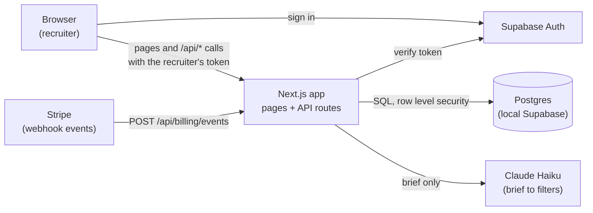
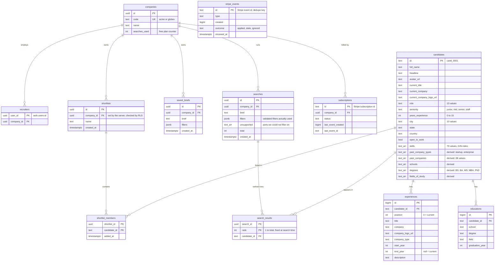
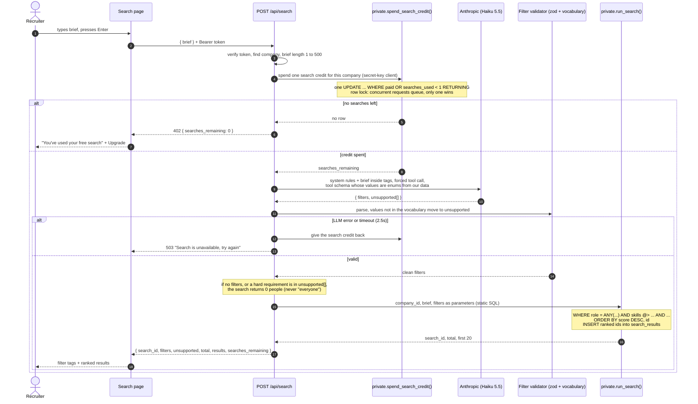
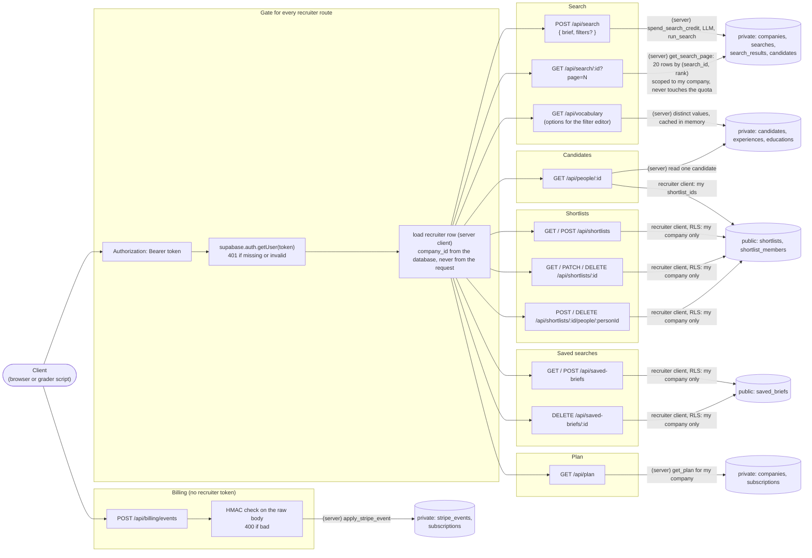
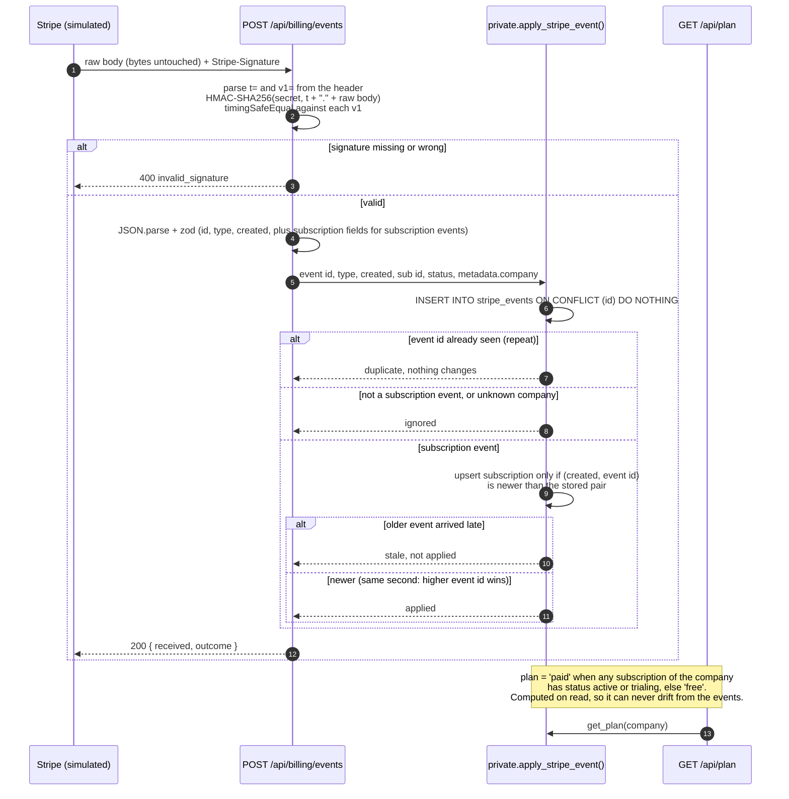
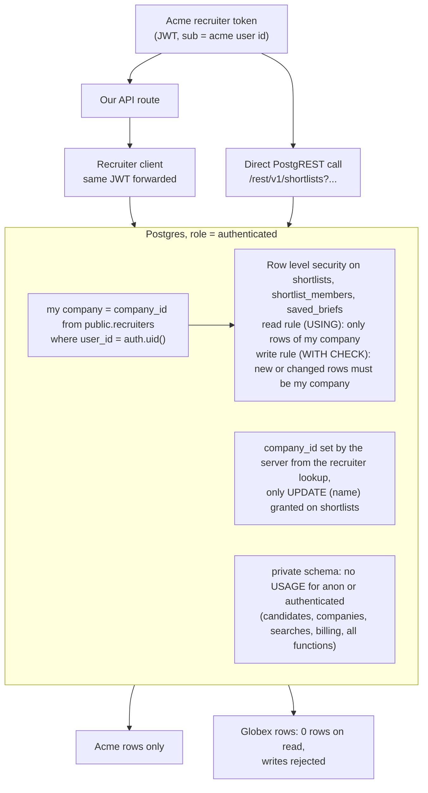

# Diagrams

Generated from `docs/diagrams/*.mmd`. Edit the `.mmd` file, then regenerate this page. Section numbers refer to [ARCHITECTURE.md](ARCHITECTURE.md).

## 01. High-level design

Source: [`01-high-level-design.mmd`](diagrams/01-high-level-design.mmd)

## 02. Data model (core entities)

Source: [`02-data-model.mmd`](diagrams/02-data-model.mmd)

## 03. Search flow (deep dive 6.1)

Source: [`03-search-flow.mmd`](diagrams/03-search-flow.mmd)

## 04. Request map: every API route

Source: [`04-request-map.mmd`](diagrams/04-request-map.mmd)

## 05. Stripe webhook (deep dive 6.5)

Source: [`05-billing-webhook.mmd`](diagrams/05-billing-webhook.mmd)

## 06. Tenant isolation (deep dive 6.4)

Source: [`06-tenancy.mmd`](diagrams/06-tenancy.mmd)

## 07. Setup flow

Source: [`07-setup.mmd`](diagrams/07-setup.mmd)

```mermaid
%% How `make setup` and `make dev` bring the app up on a clean Mac.
flowchart LR
    S0["make setup"] --> S1["check Node 24 + Docker running"]
    S1 --> S2["npm ci<br/>(lockfile, pinned supabase CLI 2.119.0)"]
    S2 --> S3["npx supabase start"]
    S3 --> S4["npx supabase db reset<br/>applies migrations"]
    S4 --> S5["node scripts/seed.ts<br/>companies, 2 recruiters,<br/>5,000 candidates + derived columns"]
    S5 --> S6["write .env.local from supabase status<br/>(local URL + keys only)"]
    D0["make dev"] --> D1["next dev on :3000<br/>reads ANTHROPIC_API_KEY,<br/>STRIPE_WEBHOOK_SECRET from env"]
    S6 -.-> D0
```

