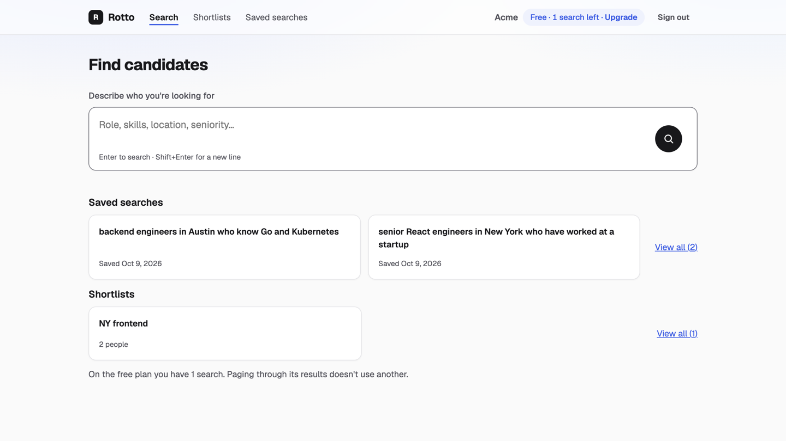

# Reviewing this project

## How to review (about 15 minutes)

1. The [README](../README.md), then [ARCHITECTURE.md](ARCHITECTURE.md) (requirements, API, high-level design, deep dives, decisions; the diagrams are inline, and the request map in section 3 shows every route).
2. Core code, in this order: `supabase/migrations` (schema, RLS), `src/server/search` (LLM and SQL), `src/server/plan.ts` (free plan), `src/server/billing` (webhook), `app/api` (thin routes).
3. Run the checks with the app running: `npm test` (unit), `npm run test:integration` (tenancy, free plan, billing, hostile briefs, latency), `npm run e2e` (Cypress), `npm run eval:search` (accuracy report), and `npm run build && npm run check:secrets` (with `make dev` stopped). `test:integration`, `e2e` and `eval:search` together call Claude about 40 times, a few cents. Details in [TESTING.md](TESTING.md).
4. Decisions and their reasons are in [ARCHITECTURE.md section 7](ARCHITECTURE.md#7-decisions); the commit history follows [IMPLEMENTATION_PLAN.md](IMPLEMENTATION_PLAN.md); working rules are in [RULES.md](../RULES.md).

## Screens

| | |
|---|---|
|  |  |
|  |  |
|  | |

On a phone: [results](screenshots/phone-03-search-results.png), [candidate](screenshots/phone-04-candidate.png), [saved searches](screenshots/phone-07-saved-searches.png), [limit](screenshots/phone-09-limit.png). `npm run screenshots` takes them again from the running app.

## Billing

Plans follow Stripe subscription events sent to `POST /api/billing/events`: the signature is checked on the raw body, each event is applied once, and an older event never overwrites a newer one. To watch it work, with `make dev` running:

```
npm run replay:stripe    # acme free, globex paid
make reset               # back to the seed state
```

## Troubleshooting

| Problem | Fix |
|---|---|
| `make setup` says Docker isn't running | Start Docker Desktop and wait until it says it's running, then run `make setup` again |
| Supabase fails to start with "no space left on device" | Docker is out of disk space: `docker system prune` (removes stopped containers and unused images), or raise the disk limit in Docker Desktop settings |
| `make dev` fails with `EADDRINUSE :::3000` | An old dev server is still running: `lsof -iTCP:3000 -sTCP:LISTEN`, then `kill <pid>` |
| A port like 54321 or 54322 is in use | Another Supabase project is running: `npx supabase stop --all`, then `make setup` |
| `make setup` says the Node version is wrong | `nvm use` (the version is in `.nvmrc`) |
| `make dev` stops asking for `ANTHROPIC_API_KEY` or `STRIPE_WEBHOOK_SECRET` | Export both in the same shell before `make dev`; the sample events use `whsec_test_sample` |
| Pages hang after running `npm run build` | `next build` and `next dev` share `.next`; stop `make dev` before building, then start it again |
